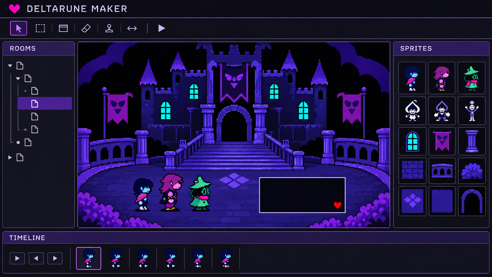

# Deltarune Maker

A fan creation studio for DELTARUNE game experiments and short films.

*Concept artwork for the studio.*

This repository begins with the studio's identity and visual direction. Each project starts with a small gameplay idea, a cast of characters, and a story worth playing through.

- Explore familiar game rules through small playable prototypes and short films.
- Give characters a reason to act, react, and change the outcome.
- Make dialogue easy to read and sound cues match what happens on screen.
- Keep titles, documentation, issues, and commit messages in English.
- Add build notes and source credits alongside each project as it grows.

One idea for a future experiment is Lancer taking his bike onto the racetrack.

**What If Lancer Was in Mario Kart?**

An unofficial fan project. DELTARUNE and its characters belong to Toby Fox and their respective creators.
