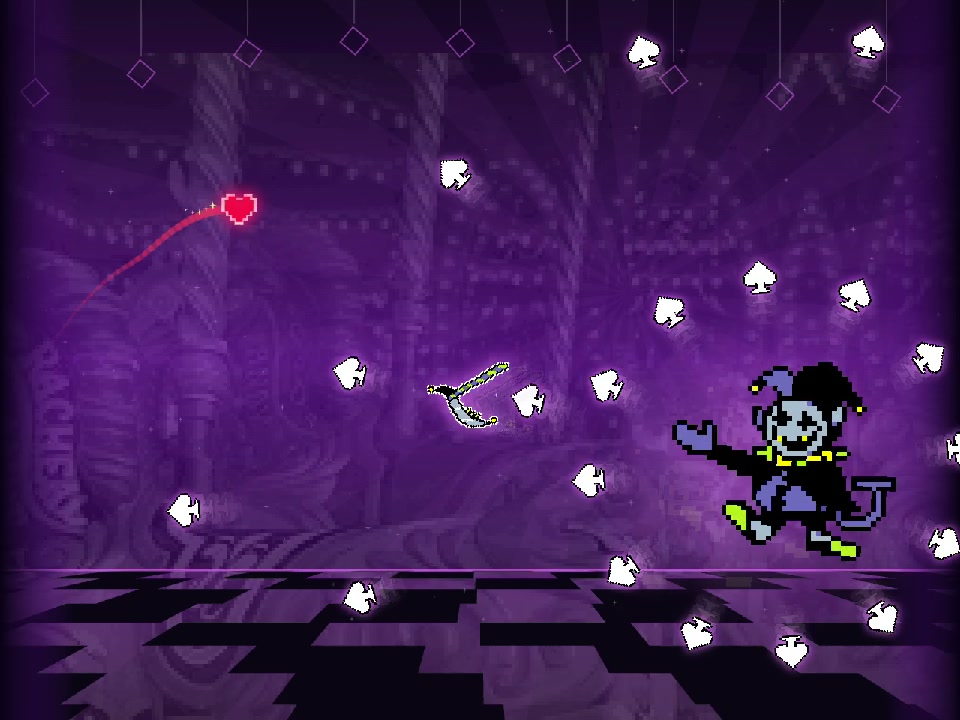
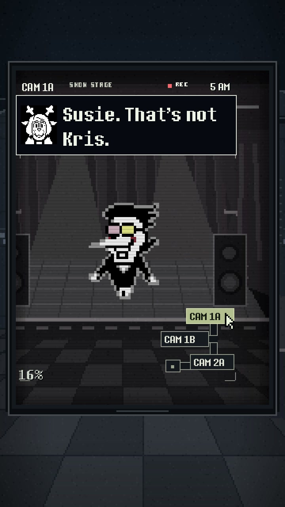
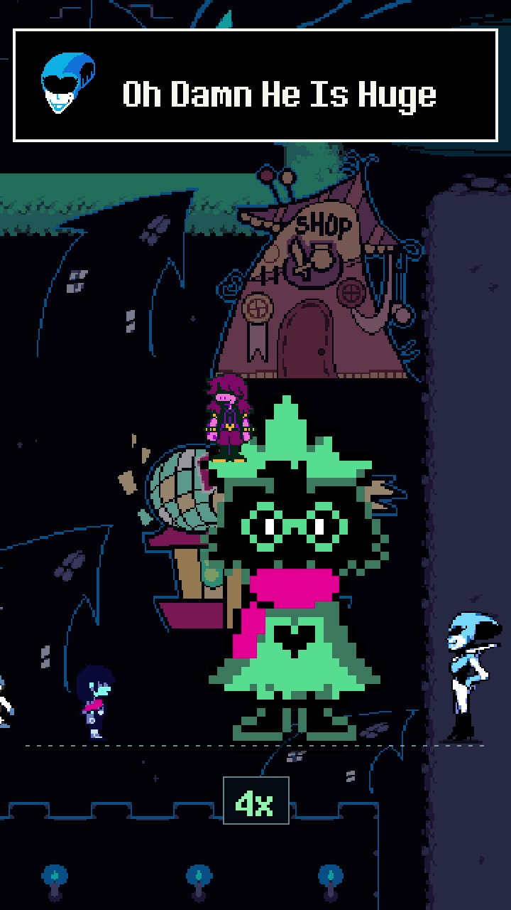

# Deltarune Maker

A fan studio for DELTARUNE game experiments and short films.

[Showcase](#showcase) · [Production workflow](docs/workflow.md) · [Agent instructions](AGENTS.md)

*Studio concept using original DELTARUNE sprites and Castle Town tiles from a [pinned game asset extraction](https://github.com/TeamBlossomDevs/DeltaruneDecomp_beta/tree/154f9a97b8f18fa6974e917c4c4e774bde6b7eba).*

## Showcase

| Example | Frame from the video | Original MP4 |
| --- | --- | --- |
| [Jevil in Geometry Dash](examples/jevil-dash/) |  | [Vertical](https://github.com/rlaope/deltarune-maker/releases/download/showcase-v1/jevil-dash-short-v2.mp4) · [Gameplay](https://github.com/rlaope/deltarune-maker/releases/download/showcase-v1/jevil-dash-gameplay-v2.mp4) |
| [Five Nights at Spamton's](examples/five-nights-at-spamtons/) |  | [Download](https://github.com/rlaope/deltarune-maker/releases/download/showcase-v1/five-nights-at-spamtons-v4.mp4) |
| [What If Ralsei Kept Doubling in Size?](examples/ralsei-doubles/) |  | [Download](https://github.com/rlaope/deltarune-maker/releases/download/showcase-v1/ralsei-doubles-v2.mp4) |

The [showcase release](https://github.com/rlaope/deltarune-maker/releases/tag/showcase-v1) holds the original delivery files. The [video catalog](examples/catalog.json) records each export's format and SHA-256.

Download the four MP4s to one folder, then run `python3 scripts/verify_showcase.py /path/to/downloads` from the repository root to check that they match the catalog.

## Work on a project

Open the repository root in Claude Code, Codex, or Hermes Agent. [AGENTS.md](AGENTS.md) holds the shared studio rules, and [CLAUDE.md](CLAUDE.md) imports them for Claude Code. For another tool, give it the shared instructions and the [production workflow](docs/workflow.md).

For new crossovers, use original game assets from each franchise and credit their sources in the example page.

Each folder under `examples/` pairs a finished video with a frame and its project notes. Keep English titles, documentation, issues, and commits together with the work.

**What If Lancer Was in Mario Kart?** is a future experiment.

An unofficial fan project. DELTARUNE and its characters belong to Toby Fox and their respective creators.
