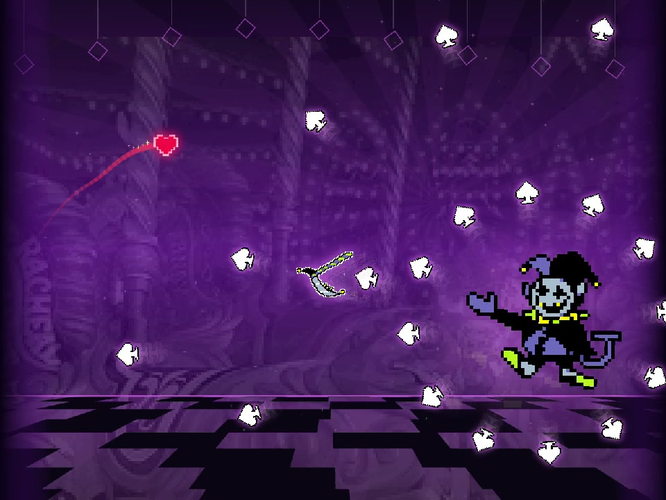

# Jevil in Geometry Dash

A Geometry Dash-style fan game with Jevil as the boss. The vertical cut adds a Bongo Miku keyboard overlay.

- [Vertical short](https://github.com/rlaope/deltarune-maker/releases/download/showcase-v1/jevil-dash-short-v2.mp4)
- [Gameplay export](https://github.com/rlaope/deltarune-maker/releases/download/showcase-v1/jevil-dash-gameplay-v2.mp4)

- Jevil's [original sprites and voice](https://deltarune.wiki/w/Jevil) and Toby Fox's [THE WORLD REVOLVING](https://tobyfox.bandcamp.com/track/the-world-revolving) are from DELTARUNE Chapter 1.
- Movement takes inspiration from [Geometry Dash](https://store.steampowered.com/app/322170/Geometry_Dash/). The keyboard art comes from kuroni's [Bongo Cat for osu!](https://github.com/kuroni/bongocat-osu/tree/0714582791529af714bc9a6a6a6f77497c7c561d), with a generated Miku wig.
