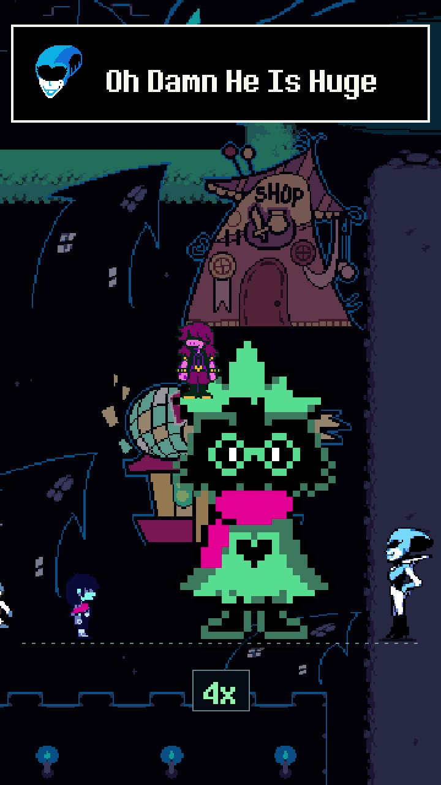

# What If Ralsei Kept Doubling in Size?

Ralsei doubles in size, outgrows Castle Town, and keeps going into space.

[Download the original MP4](https://github.com/rlaope/deltarune-maker/releases/download/showcase-v1/ralsei-doubles-v2.mp4)

Original DELTARUNE sprites, tile art, and dialogue assets come from pinned [Chapter 1](https://github.com/TeamBlossomDevs/DeltaruneDecomp_beta/tree/985d441b60eb0786f2d1dd5ddc1a8c4a7d7d1527) and [Chapter 2](https://github.com/TeamBlossomDevs/DeltaruneDecomp_beta/tree/154f9a97b8f18fa6974e917c4c4e774bde6b7eba) extractions. The music is Toby Fox's [My Castle Town](https://tobyfox.bandcamp.com/track/my-castle-town). The space ending uses the [Fangamer Hat Ralsei Plush](https://www.fangamer.com/products/deltarune-ralsei-plush).
